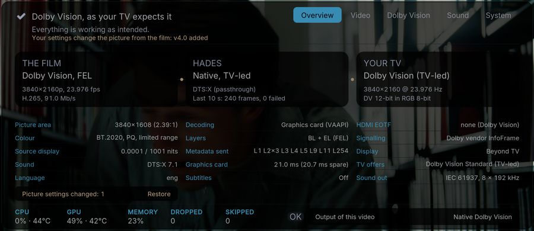
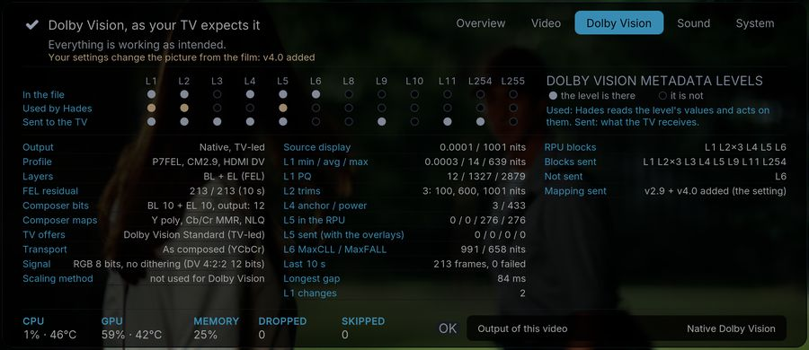

# Hades PPI window

A Kodi add-on that opens the [LibreELEC Hades](https://github.com/hadesdevls/LibreELEC-Hades) player-information
panel as a window of its own, so it looks the same in every skin and does not replace any Hades or skin file.

Tested on LibreELEC Hades (Kodi 22) with the skin Arctic Fuse 3; not tested elsewhere.

  
  

## What it does

- Shows the Hades pages (overview, video, Dolby Vision, sound, system) with Hades' own values and texts.
- Bind a key to `RunScript(script.hades.ppi.window)` (for example with Keymap Editor). The same key or Back closes it.
- Rounded panel, adjustable colours and opacity, separate colours for the speaker circles and the height channels.
- Atmos / DTS:X: the four height channels can be shown (7.1.4 / 5.1.4 assumed); can be turned off.
- Restore button for changed picture settings, and the upscaler / Dolby Vision output lists, as in Hades.
- Optional web server for the TinyPPI Mobile app (off by default).

## Install

Download the add-on zip, then in Kodi: Add-ons > Install from zip file. Restart Kodi after an update.

## Known limits

- Needs Hades: the values come from the `hades.*` properties of its core.
- While the window is open, the Kodi seek bar is closed when it appears on left/right.
- The key that opens the panel is not set by the add-on.

## Thanks

- **[LibreELEC Hades](https://github.com/hadesdevls/LibreELEC-Hades)** (hadesdevls): the player-information panel,
  its values and its texts are theirs; this add-on only shows them in a window of its own. Without Hades there would
  be nothing to show.
- **[TinyPPI Mobile](https://github.com/CE-Repo/tinyppi-mobile)** (jamal2367) and the TinyPPI add-on: the idea of a
  separate view of the player information, and the app the optional server is made for.
- **Kodi / Team Kodi** and the skin **Estuary**, from which the panel is derived.
- **[Inter](https://github.com/rsms/inter)** (The Inter Project Authors): the font of the window.

## Licence

GPL-2.0-only; see `LICENSE` and `NOTICE.md`.
